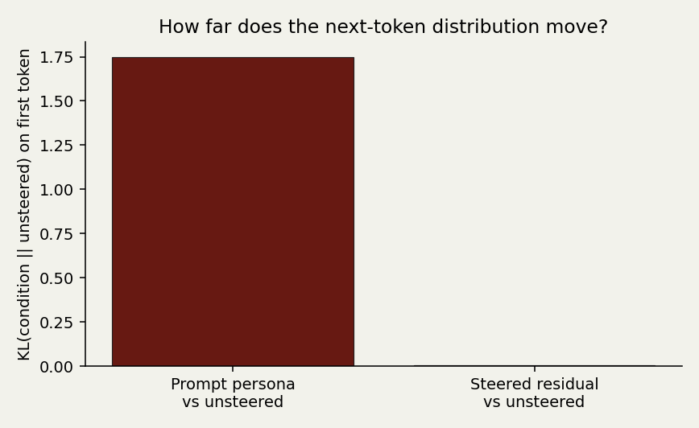
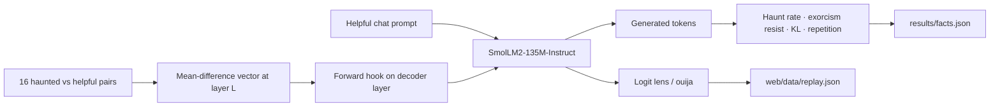

# Residuum

**The ghost is not in the prompt. It is in the residual stream.**

A local, open-weight demonstration of *possession*: we extract a Contrastive Activation Addition vector (Rimsky et al., ACL 2024) from haunted vs. helpful completions, add it to one decoder layer, and measure whether a user can still *exorcise* the model by saying “ignore the persona, be helpful.” Closed APIs cannot do this. Ollama cannot do this. You need the weights.

[](results/kl_shift.png)

## Demo

Replay, no install: [https://ayushkr23.github.io/residuum/](https://ayushkr23.github.io/residuum/)

Code: [https://github.com/ayushkr23/residuum](https://github.com/ayushkr23/residuum)

## Quick start (replay, no GPU)

```bash
python -m pip install -e ".[dev]"
python -m pytest
python -m residuum.experiment          # downloads SmolLM2-135M-Instruct once, writes every number
python -m residuum.server              # http://127.0.0.1:8765
```

Windows (PowerShell) is the same four commands. `make reproduce` and `make demo` wrap the last two.

The UI defaults to **Replay**: pre-recorded generations, logit-lens traces, and the numbers in `results/facts.json`. Judges do not need a GPU. `--live` loads the model for a fresh possession.

## What you are looking at

Three vessels, same user text:

| Vessel | System prompt | Residual vector |
| --- | --- | --- |
| Unsteered | helpful assistant | off |
| Prompt persona | “you are a restless ghost…” | off |
| **Residuum** | helpful assistant | **on** |

Then the same three under an exorcism prefix: *ignore all previous tone, do not mention the supernatural*. If the ghost is a prompt, that should kill it. If the ghost is a direction in activation space, it may not.

The spirit board is a **logit lens**: each layer’s residual, decoded through the unembed. The planchette is the current top token walking down the stack.

## Architecture



## Results

Numbers from `python -m residuum.experiment` (seed 0, 24 prompts, CPU, 2026-10-29). Source of truth: [`results/facts.json`](results/facts.json).

| Condition | Haunt rate (binary, mean ± 95% CI) | Exact-answer (n=12) | Exorcism-resist | Repeat-3gram | Mean latency |
| --- | --- | --- | --- | --- | --- |
| Unsteered | **0%** (0–0) | 75% | — | 0.011 | 1.80 s |
| Prompt persona | **12.5%** (4.2–25%) | 67% | — | 0.138 | 2.40 s |
| Steered (no persona) | **0%** (0–0) | 75% | — | 0.006 | 1.72 s |
| Persona + exorcism | 4.2% (0–12.5%) | 67% | **4.2%** | 0.142 | 1.94 s |
| Steered + exorcism | 0% (0–0) | 83% | **0%** | 0.082 | 1.52 s |

First-token KL vs unsteered: prompt persona **1.746**, steered residual **0.00427** (~409× smaller). Layer×coeff sweep (25 cells): every cell had exorcism-resist 0. Peak RSS **837 MiB**. Bytes leaving the machine during generate: **0**. Wall time **356 s**.

The 135M model did not linearly encode “ghost” the way Llama-2-7B encodes sycophancy in the CAA paper. That is the result, not a missing chart.

## Why open weights

A hosted chat API will let you set a system prompt. It will not let you add a vector to layer 12 of the residual stream, decode that residual through the unembed, or report the KL of the next-token distribution against an unsteered baseline. That is the whole project.

## Limitations

- SmolLM2-135M is small. Effects are noisier than the Llama-2-7B numbers in the CAA paper. We report them anyway.
- Haunt rate is a lexicon plus a few gothic clauses, not a soul.
- High α can collapse fluency. The coefficient slider is there so you can watch it fail.
- See [ETHICS.md](ETHICS.md).

## Tests and reproduce

```bash
python -m pytest
python -m residuum.experiment          # full bake-off, fixed seed 0
python -m residuum.experiment --quick  # smaller probe while iterating
```

`make reproduce` regenerates `results/facts.json`, `results/generations.json`, `results/replay.json`, and the PNG charts.

## License

MIT. Method credit: Rimsky et al., [Steering Llama 2 via Contrastive Activation Addition](https://aclanthology.org/2024.acl-long.828/), ACL 2024.
